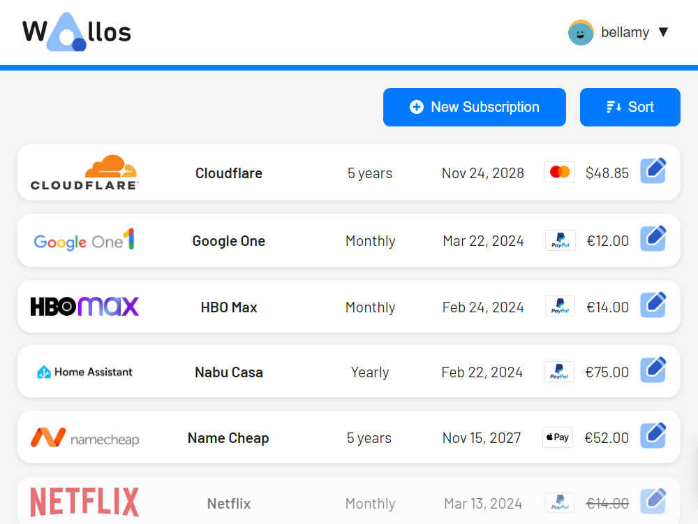

# Wallos

Wallos is a self-hosted subscription tracker: add every recurring subscription, see what it costs per month and per year, set budgets per category, and get reminded before renewals. It is a single lightweight PHP service with an SQLite database — no companion database — built for anyone who wants their subscription spending on their own server instead of a SaaS.

*Wallos' subscriptions dashboard — upstream screenshot from the Wallos project (`images/screenshots/desktop.png`), showing the subscription list, monthly/yearly totals, and categories. The live UI was verified rendering during end-to-end testing of this template's own deployment.*

## Source Repository

[https://github.com/INAPP-Mobile/wallos](https://github.com/INAPP-Mobile/wallos)

## Deploy and Host

One-click deploy creates a single Wallos service with a persistent volume. No companion database is needed: Wallos stores subscriptions, users, and settings in SQLite under the volume. On first boot the wrapper remaps nginx from its hardcoded `:80` to Railway's injected `PORT`, symlinks the database and logo directories onto the volume, and the upstream startup script creates and migrates the database. There is no setup wizard and no email step: open the public URL and register the first account — it becomes the admin.

After deploy, register your account, then add a subscription (name, price, currency, cycle, next payment date, category, payment method) and it appears on the dashboard with its monthly and yearly cost. Custom logos can be uploaded per subscription and are stored on the volume.

## Why Deploy

- See the real cost: monthly and yearly totals across all subscriptions, with per-category breakdowns.
- Budgets that warn you: set a monthly budget per category and Wallos flags when you go over.
- Renewal reminders: email notifications before a subscription renews (configure SMTP in the admin settings) and a calendar view of upcoming payments.
- Multi-currency: prices in 30+ currencies with automatic exchange-rate updates.
- Household sharing: add household members and split who pays for what.
- No database service to run: one always-on PHP service with SQLite on a persistent volume.
- Self-hosted data: your subscription list stays on your Railway volume, with no tracking and no subscription.

## Common Use Cases

- Individuals who want one place listing every streaming, software, and utility subscription and its true yearly cost.
- Households tracking shared subscriptions and who pays for each.
- Budget-conscious users setting per-category caps (e.g. Entertainment) and getting warned before overspending.
- A private alternative to hosted subscription trackers, with the data on your own volume.

## Configuration

The one-click deploy form is empty — Wallos needs no variables to deploy. Everything else is baked into the image; applicable upstream variables and their baked values:

| Variable | Value | Description |
| --- | --- | --- |
| `PORT` | Railway-injected | The HTTP port: the wrapper rewrites nginx's listen lines to `$PORT` on every boot (upstream hardcodes `:80`). |
| `TZ` | `UTC` | Container timezone (baked; override as a service variable after deploy if you want another zone). Wallos also has a per-user timezone setting in its admin UI. |
| `OIDC_ENABLED` | unset (`false`) | Optional single sign-on via OpenID Connect; see `.env.example` for the full `OIDC_*` set. Password login stays enabled unless `OIDC_DISABLE_PASSWORD_LOGIN` is set. |
| `SSRF_ALLOWLIST` | unset | Optional allowlist overriding the Security Settings allowlist in the Admin UI. |

## Persistence

One volume mounted at `/data` holds both persistent directories: `/data/db` (the SQLite database, `wallos.db`) and `/data/logos` (uploaded subscription logos). They are symlinked into the webroot on every boot. Restarts and redeploys keep accounts, subscriptions, categories, budgets, and settings. Back up the volume to back up Wallos.

## Deployment Dependencies

- Plan tier: works on Railway's entry tiers; a single always-on service with a persistent volume.
- RAM needs: light — one PHP + nginx service, ~19 MB at rest, no companion database or cache service.
- Upstream: [Wallos v5.10.4](https://github.com/ellite/Wallos) (GPL-3.0), image pinned by manifest digest.
