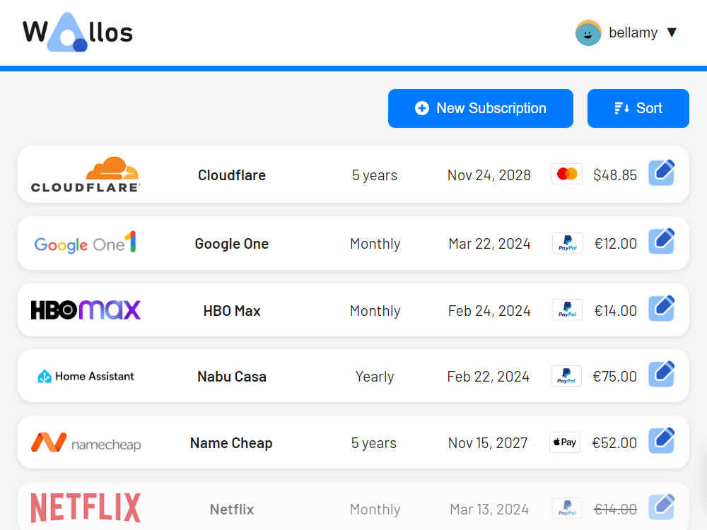

*Wallos' subscriptions dashboard — upstream screenshot from the Wallos project (`images/screenshots/desktop.png`). The live UI was verified rendering during end-to-end testing of this template's own deployment.*

# Deploy and Host

Wallos is a self-hosted subscription tracker: add every recurring subscription, see what it costs per month and per year, set budgets per category, and get reminded before renewals. One-click deploy creates a single Wallos service with a persistent volume and no companion database: subscriptions, users, and settings live in SQLite on the volume. After deploy, open the public URL and register the first account — it becomes the admin. There is no setup wizard and no email step.

## About Hosting

Hosting Wallos on Railway keeps your subscription list on your own volume instead of a SaaS. The deployment is a single always-on PHP service: the wrapper remaps nginx from its hardcoded `:80` to Railway's injected `PORT` on every boot, symlinks the database and logo directories onto the volume, and the upstream startup script creates and migrates the database. The deploy form is empty — Wallos needs no variables to deploy.

## Why Deploy

- See the real cost: monthly and yearly totals across all subscriptions, with per-category breakdowns.
- Budgets that warn you: set a monthly budget per category and Wallos flags when you go over.
- Renewal reminders: email notifications before a subscription renews (configure SMTP in the admin settings) and a calendar view of upcoming payments.
- Multi-currency: prices in 30+ currencies with automatic exchange-rate updates.
- Household sharing: add household members and split who pays for what.
- No database service to run: one always-on PHP service with SQLite on a persistent volume.
- Self-hosted data: your subscription list stays on your Railway volume, with no tracking and no subscription.

## Common Use Cases

- Individuals who want one place listing every streaming, software, and utility subscription and its true yearly cost.
- Households tracking shared subscriptions and who pays for each.
- Budget-conscious users setting per-category caps (e.g. Entertainment) and getting warned before overspending.
- A private alternative to hosted subscription trackers, with the data on your own volume.

## Dependencies for

- A single Wallos service (PHP + nginx, SQLite, no companion service).
- One persistent volume mounted at `/data` (SQLite database under `/data/db`, uploaded logos under `/data/logos`).
- Environment variables (condensed reference — full documentation in the repo README):

| Variable | Default | Description |
| --- | --- | --- |
| `PORT` | Railway-injected | The HTTP port, remapped by the wrapper on every boot (upstream hardcodes `:80`). |
| `TZ` | `UTC` | Container timezone (baked; override after deploy). A per-user timezone setting also exists in the admin UI. |
| `OIDC_ENABLED` | unset | Optional OpenID Connect single sign-on; see the repo `.env.example` for the full `OIDC_*` set. |
| `SSRF_ALLOWLIST` | unset | Optional allowlist overriding the Security Settings allowlist in the Admin UI. |

### Deployment Dependencies

- Plan tier: works on Railway's entry tiers; a single always-on service with a persistent volume.
- RAM needs: light — one PHP + nginx service, ~19 MB at rest, no companion database or cache service.
